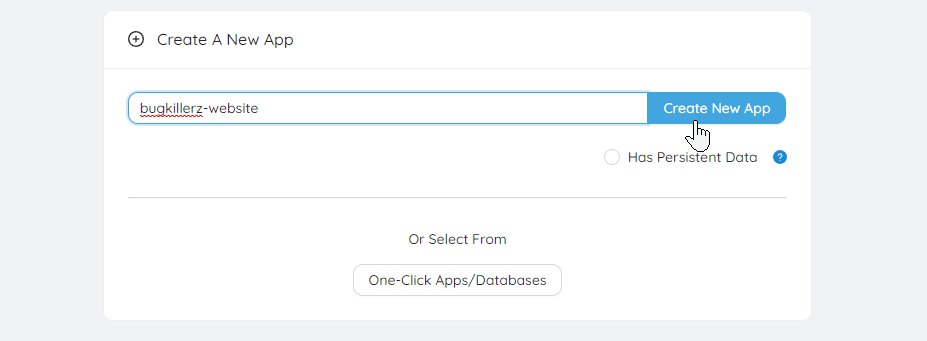
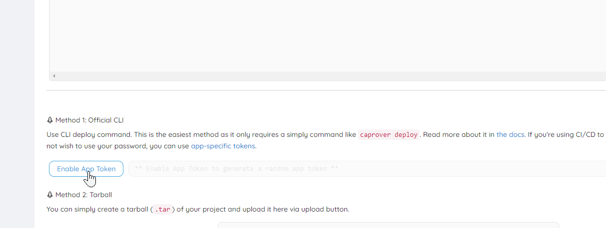
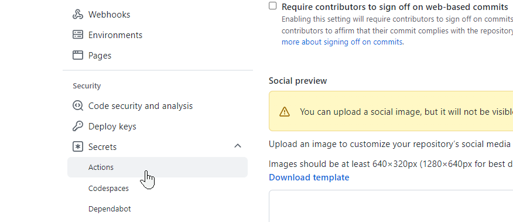
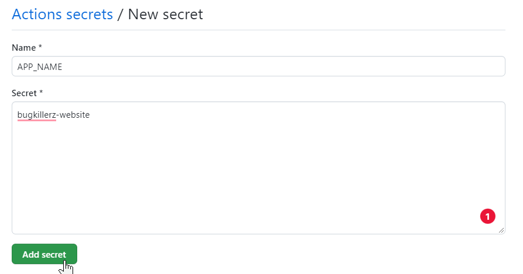

## 直接从 GitHub 部署

本示例展示了一个带 PHP backend 的 Vue 3 app，如何使用 CapRover 社区维护的 [GitHub Action](https://github.com/caprover/deploy-from-github)，直接从 GitHub 构建、测试并部署到 CapRover。你可以从 https://github.com/PremoWeb/SDK-Foundation-Vue clone 一个示例 project 试用，或用它构建你的下一个出色 app。

### 创建新 App

你在这里选择的名称将成为 APP_NAME secret。



### 启用 App Token

找到新 app 的 “Deployment” tab，点击 Enable App Token 并复制此 token。这就是你的 APP_TOKEN secret。



### 添加 GitHub Secrets



<hr />



_对 APP_TOKEN 和 CAPROVER_SERVER secret 重复此过程。_

注意：CapRover server 必须采用 "https://captain.apps.your-domain.com" 格式。你可以将 CAPROVER_SERVER 设置为所有私有和公共 projects 的 Global Secret。

<hr />

### 向 project 添加文件

使用这种方式部署到 CapRover，至少需要两个文件。

第一个文件是 CapRover 部署 app 时使用的 `captain-definition` 文件。另一个文件是 Github Actions 用来在部署前处理 project 的 workflow yaml 文件。

将新的 Workflow file 保存到 `.github/workflows/deploy.yml`，内容如下：

```
name: Build & Deploy

on:
  push:
    branches: [ "main" ]

  pull_request:
    branches: [ "main" ]

jobs:
  build-and-deploy:
    runs-on: ubuntu-latest

    strategy:
      matrix:
        node-version: [18.x]

    steps:
      - name: Check out repository
        uses: actions/checkout@v4
      - name: Use Node.js ${{ matrix.node-version }}
        uses: actions/setup-node@v3
        with:
          node-version: ${{ matrix.node-version }}
          cache: "npm"
      - run: npm ci
      - run: npm run build --if-present
      - run: npm run test --if-present

      - uses: a7ul/tar-action@v1.1.0
        with:
          command: c
          cwd: "./"
          files: |
            backend/
            frontend/dist/
            captain-definition
          outPath: deploy.tar

      - name: Deploy App to CapRover
        uses: caprover/deploy-from-github@v1.0.1
        with:
          server: '${{ secrets.CAPROVER_SERVER }}'
          app: '${{ secrets.APP_NAME }}'
          token: '${{ secrets.APP_TOKEN }}'
```

快速说明一下上面展示的内容：

第一步使用 NPM 检出并构建 app 的 Vue 3 frontend。构建输出位于 frontend/dist/。如果存在测试，app 也会在第二步之前完成测试。

第二步将 `backend/`、`frontend/dist/` directories 和 `captain-definition file` 复制到 deploy.tar file 中。

最后一步会将 tarball file 发送给 CapRover，使 CapRover 可以开始部署 app。

### 提交代码更改以进行部署！

当你将 files 提交到 project repo 的 “main” branch 时，Github Actions 会启动 Workflow file 的处理。完成后，你会在短短几秒内看到 app 部署到 Caprover！Github 发现的任何错误都会自动触发 email 通知。没有 email 就表示部署成功！

<hr />

### 替代方式（更高效）

另外，你甚至可以在 Github 上构建 Docker image，然后只将构建好的 artifact 部署到 CapRover instance。这样可以避免占用 CapRover instance 的 RAM 和 CPU 来构建 image。

为此，我们需要执行以下步骤：使用 GitHub Actions 构建 Docker image，使用 GitHub Packages 存储它，然后部署到 CapRover。

#### 创建 GitHub Personal Access Token

你需要创建一个对 **packages 具有 write permission** 的 GitHub Personal Access Token。

如果你以前没有创建过 Personal Access Token，GitHub 有一份很好的指南：https://docs.github.com/en/authentication/keeping-your-account-and-data-secure/creating-a-personal-access-token

#### 创建新 App

如果 CapRover 上还没有 app，请按照[这里](#创建新-app)的说明创建一个。

如果 CapRover 上已经有 app，可以跳过此步骤。

#### 启用 App Token

如果你的 app 还没有 app token，请按照[这里](#启用-app-token)的说明创建一个。

如果已有 app token，请准备好，下一步会用到它。

#### 添加 GitHub Secrets

你需要将以下信息添加到 GitHub Secrets：

- App Name：CapRover 中 app 的名称
- App Token：上一步获取的 app token
- CapRover Server URL：CapRover Server 的 URL
- GitHub Token：上一步创建的 GitHub Personal Access Token

可以按照[这里](#添加-github-secrets)的说明添加 GitHub Secrets。

#### 向 CapRover 添加 private Docker Registry

为了从 GitHub Packages 拉取 image，你需要向 CapRover 添加 private Docker registry。如果以前没有做过，可以按照[这里](https://caprover.com/docs/app-scaling-and-cluster.html#add-a-private-docker-registry)的说明操作。

使用以下值：

- Username：`<your github username>`
- Password：`<your github personal access token>`
- Domain：`ghcr.io`（不要添加 www 或 http）
- Image Prefix：`<your github username or your org username>`（如果从不同于你 username 的 org 拉取 images）

> 如果 image prefix 是你的 github username，prefix **必须**为小写

#### 创建 GitHub Action

GitHub Actions 是 GitHub 内置的 CI/CD pipeline。如果你不熟悉它，建议通过阅读 GitHub 的 Understanding GitHub Actions Docs 了解基础知识：https://docs.github.com/en/actions/learn-github-actions/understanding-github-actions

以下是一个 GitHub Action 示例：它会在每次 pull request 时构建 Docker container，并将其部署到 CapRover server（适合开发环境设置）。

```
name: Build and Deploy Docker Image

on: [pull_request]

jobs:
  build_and_deploy:
    runs-on: ubuntu-latest

    steps:
    - name: Check out repository
      uses: actions/checkout@v4

    - name: Set up Docker Buildx
      uses: docker/setup-buildx-action@v3

    - name: Login to Container Registry
      uses: docker/login-action@v3
      with:
            registry: ghcr.io
            username: ${{ github.repository_owner }}
            password: ${{ secrets.GITHUB_TOKEN }}

    - name: Preset Image Name
      run: echo "IMAGE_URL=$(echo ghcr.io/${{ github.repository_owner }}/${{ github.event.repository.name }}:$(echo ${{ github.sha }} | cut -c1-7) | tr '[:upper:]' '[:lower:]')" >> $GITHUB_ENV

    - name: Build and push Docker Image
      uses: docker/build-push-action@v5
      with:
        context: .
        file: ./Dockerfile
        push: true
        tags: ${{ env.IMAGE_URL }}

    - name: Deploy Image to CapRrover
      uses: caprover/deploy-from-github@v1.1.2
      with:
        server: "${{ secrets.CAPROVER_SERVER }}"
        app: "${{ secrets.APP_NAME }}"
        token: "${{ secrets.APP_TOKEN }}"
        image: ${{ env.IMAGE_URL }}
```

下面简要解释此 action 中每一步的作用：

1. **Check out repository**：此步骤使用 action `actions/checkout@v2`。这是一个预定义的 GitHub Action，允许 workflow 访问 repo 内容。checkout action 会将 repo clone 到 runner（GitHub Actions 用来执行 workflows 的 virtual environment），因此 workflow 后续步骤都能在其上运行。
2. **Set up Docker Buildx**：此步骤使用 action `docker/setup-buildx-action@v1`，这是一个用于设置 Docker Buildx 的 Docker action，可提供更高级的 container 构建能力。
3. **Login to Container Registry**：此步骤使用 `docker/login-action@v2`，通过 repo owner 的 username 和 GitHub Token（GITHUB_TOKEN）登录 GitHub Container Registry（ghcr.io）。此 token 必须预先存储在 repo 的 secrets 中。
4. **Preset Image Name**：这是一个构造 Docker image URL 的 shell command。它使用 GitHub repo owner、repo name 和当前 commit 的 SHA（截取前 7 个字符）构造 URL，将所有大写字符转换为小写，然后把 URL 写入 `GITHUB_ENV`，供后续步骤作为 environment variable 使用。
5. **Build and push Docker Image**：此步骤使用 `docker/build-push-action@v4`，通过 repo 中的 Dockerfile 构建 Docker image，并将其推送到上一阶段设置的 URL 对应的 GitHub Container Registry。`context: .` 表示构建 context 是当前 directory（即 repo 根目录）。
6. **Deploy Image to CapRover**：此步骤使用 `caprover/deploy-from-github@v1.1.2` action，将刚刚构建并推送的 Docker image 部署到 CapRover。CapRover server、application name 和 access token 的详情来自 repo 的 secrets。Docker image URL 取自之前设置的 environment variable。

#### 部署！

完成这些更改后，将它们 commit + push 到 repo，然后查看部署结果 🪄

### 需要帮助？

我们提供商业和社区支持。详情请访问 [Help and Support](/docs-legacy/support "Help and Support") 页面。
